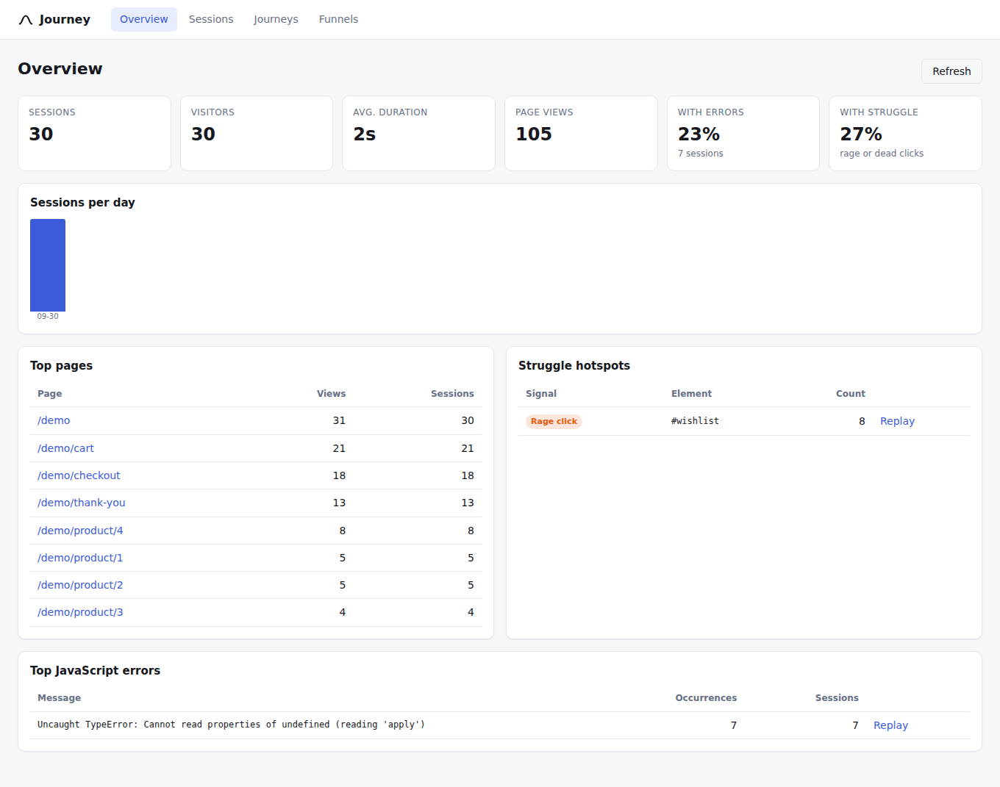
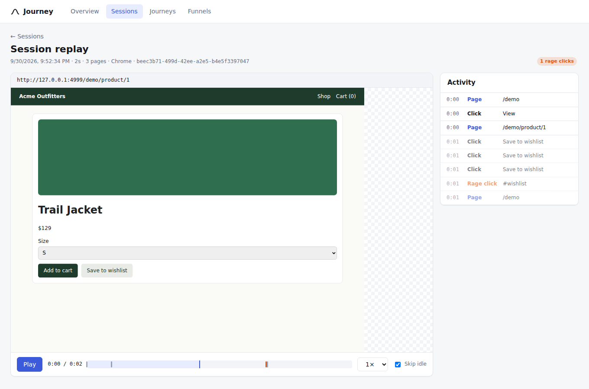
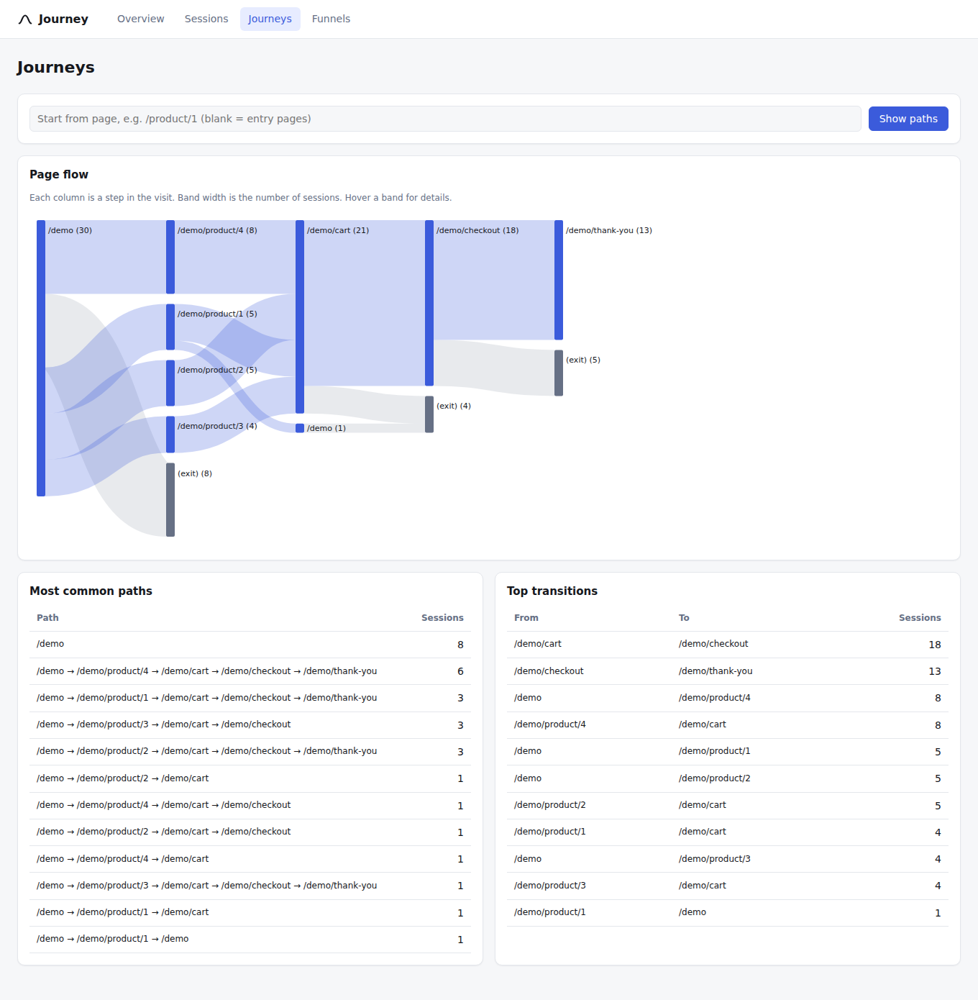
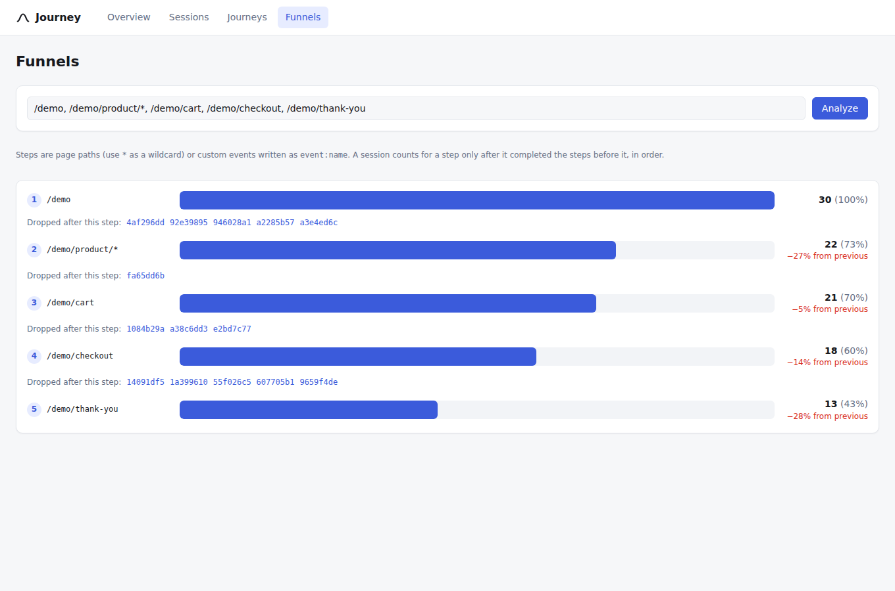

# Journey

Session capture, replay and journey analytics for websites, in the style of HCL Discover and Glassbox.

Add one script tag to a site and Journey records what each visitor does: page views, clicks, form
inputs (masked), scrolling, mouse movement, JavaScript errors, and the DOM itself, so every session
can be replayed like a video. The dashboard lets you search sessions, replay them, see where people
struggle (rage clicks, dead clicks, errors), follow their paths through the site, and measure funnels.

| Overview | Replay |
| --- | --- |
|  |  |
| **Journeys** | **Funnels** |
|  |  |

## Quick start

Requires Node 22.13 or newer (uses the built-in `node:sqlite`, so there is no native build step).

```bash
npm install
npm run build
npm start                      # collector + dashboard on http://localhost:4400
```

Open http://localhost:4400/demo, click around the demo shop, then open http://localhost:4400 to see
the session. To fill the dashboard with realistic traffic, run `npm run simulate -- http://localhost:4400 30`
(drives the demo shop in headless Chromium).

## Add it to a website

```html
<script src="https://YOUR-COLLECTOR/journey.js" async></script>
```

The endpoint defaults to the host that served the script. Options, as `data-` attributes or via
`window.JourneyConfig` before the script loads:

| Option | Default | Meaning |
| --- | --- | --- |
| `endpoint` / `data-endpoint` | `<script origin>/v1/ingest` | Where batches are sent |
| `ingestKey` / `data-key` | none | Sent as `x-journey-key`; required when the collector sets `JOURNEY_INGEST_KEY` |
| `sampleRate` / `data-sample-rate` | `1` | Share of sessions recorded (decided per session) |
| `maskAllInputs` | `true` | Mask every input value unless opted out |
| `maskSelector` | `[data-journey-mask]` | Mask text and values inside these elements |
| `unmaskSelector` | `[data-journey-unmask]` | Record input values inside these elements (never passwords, emails, phone, card fields) |
| `blockSelector` | `[data-journey-block]` | Do not record content at all; replaced by a grey box |
| `scrubPatterns` | `true` | Scrub emails, card numbers, SSNs and phone numbers from any recorded text |
| `sessionTimeoutMs` | 30 min | Inactivity before a new session starts |

JavaScript API: `Journey.identify('user-42', { plan: 'pro' })`, `Journey.track('order_placed', { value: 99 })`,
`Journey.stop()`, `Journey.sessionId`.

## What is captured

| Event | Notes |
| --- | --- |
| Full DOM snapshot | On load and every 5 minutes (checkpoint). Scripts and inline handlers are never recorded. |
| DOM mutations | Incremental adds, removes, attribute and text changes |
| Navigation | Full page loads plus SPA `pushState`, `replaceState`, `popstate`, `hashchange` |
| Clicks | Element, stable CSS selector, visible text (scrubbed), coordinates |
| Inputs | Masked by default; checkboxes and selects recorded as state |
| Scroll, mouse move, resize | Throttled |
| Errors | `window.onerror` and unhandled promise rejections, with stack |
| Custom events | `Journey.track`, `Journey.identify` |

Struggle signals are computed by the collector at ingest time:

* **Rage click**: 3 or more clicks within 1 second and 30 px.
* **Dead click**: a click followed by no DOM change, input or navigation within 1 second.
* **Error**: any captured JavaScript error.

## Architecture

```
 browser                          collector (Node)                          dashboard (React)
 ┌──────────────┐  POST /v1/ingest  ┌─────────────────────────────┐  /api/*  ┌──────────────────┐
 │ journey.js   │ ────────────────▶ │ supervisor ─▶ worker        │ ◀──────── │ Overview         │
 │  recorder    │  batched JSON     │   validate, de-duplicate    │           │ Sessions search  │
 │  mask/scrub  │  retry + outbox   │   struggle detection        │           │ Replay (iframe)  │
 │  transport   │                   │   SQLite (WAL)              │           │ Journeys, Funnels│
 └──────────────┘                   └─────────────────────────────┘           └──────────────────┘
```

### Project layout

```
journey/
├── src/
│   ├── sdk/          capture snippet that runs on customer sites (journey.js)
│   │                   recorder.ts, serializer.ts (DOM mirror), mask.ts (privacy), transport.ts (delivery)
│   ├── collector/    Node service: ingest, storage, analytics, health, supervisor
│   │                   app.ts (HTTP), ingest.ts, analytics.ts, db.ts, supervisor.ts, worker.ts, main.ts
│   ├── dashboard/    React app: pages/ (Overview, Sessions, Replay, Journeys, Funnels), components/
│   ├── replay/       rebuilds recorded pages in a sandboxed iframe (used by the dashboard)
│   └── shared/       event types shared by all three
├── test/             unit and integration tests, one file per area; e2e/ runs a real browser
├── demo/             demo shop used for trying it out and for the browser tests
├── scripts/          build and traffic simulator
└── docs/screenshots/
```

### HTTP API

| Route | Purpose |
| --- | --- |
| `POST /v1/ingest` | Batch of events from the SDK (text/plain or JSON, optional gzip) |
| `GET /api/sessions?q=&url=&hasError=1&struggle=1&from=&to=&minDuration=&limit=&offset=` | Search |
| `GET /api/sessions/:id` | Session summary, events, pages and signals for replay |
| `GET /api/funnel?steps=/,/product/*,/cart,event:order_placed` | Ordered funnel with drop-off samples |
| `GET /api/journeys?depth=5&width=6&start=/cart` | Page-flow graph, top paths, transitions |
| `GET /api/overview` | Totals, top pages, top errors, struggle hotspots, sessions per day |
| `GET /healthz`, `GET /readyz`, `GET /metrics` | Liveness, readiness (DB and event loop), counters |

## Self-healing

**In the browser (SDK)**

* Failed sends retry with exponential backoff and jitter; `429 Retry-After` is honoured.
* A circuit breaker stops calling a collector that keeps failing and parks batches in a
  size-bounded `localStorage` outbox. The outbox drains in order on start-up, when the browser comes
  back online, and after the next successful send.
* `413 Payload Too Large` splits the batch and retries each half.
* `sendBeacon` on page hide, falling back to the outbox.
* Every listener is wrapped so an SDK error can never break the host page. An internal error triggers a
  fresh snapshot to resynchronise the DOM mirror, and the SDK stops itself after repeated failures.
* A corrupt outbox or full storage is detected and discarded rather than crashing.

**In the collector**

* A supervisor process restarts the worker when it exits (exponential backoff, reset after a stable
  minute) and kills and replaces a worker whose `/readyz` probe fails 3 times in a row (hung event loop,
  broken database).
* Workers exit on uncaught exceptions so they restart clean.
* Retried batches are de-duplicated by `(session, seq)`, so at-least-once delivery never double counts.
* A database file that fails `PRAGMA quick_check` at start-up is moved aside and replaced.
  Repeated storage errors cause the handle to be reopened. Storage errors return `503 Retry-After`
  so the SDK keeps the data and retries.
* Malformed events are dropped individually instead of rejecting the whole batch; damaged rows are
  skipped on read so replays still load.
* Retention purge (`JOURNEY_RETENTION_DAYS`, default 30).

**In the dashboard**

* API calls retry on network errors and 5xx, so a collector restart is invisible.
* An error boundary per view offers "Try again" instead of a blank page.
* The replayer skips missing nodes and bad attributes and reports how many steps it recovered from.

## Configuration

| Variable | Default | Meaning |
| --- | --- | --- |
| `PORT` | `4400` | HTTP port |
| `JOURNEY_DB` | `data/journey.db` | SQLite file |
| `JOURNEY_INGEST_KEY` | none | Require this key on ingest |
| `JOURNEY_ADMIN_TOKEN` | none | Require `Authorization: Bearer <token>` (or `?token=`) on `/api/*` and open the dashboard with `?token=` |
| `JOURNEY_RETENTION_DAYS` | `30` | Delete sessions older than this |
| `JOURNEY_NO_SUPERVISOR` | unset | `1` runs the worker directly (for systemd or Kubernetes, which restart on their own) |
| `LOG_LEVEL` | `info` | `debug`, `info`, `warn`, `error` (JSON lines) |

Docker: `docker compose up --build` (restart policy and health check included).

## Tests

```bash
npm test          # 62 unit and integration tests (jsdom, in-memory SQLite, real HTTP, real child processes)
npm run test:e2e  # real Chromium: demo shop -> collector -> dashboard replay, plus an outage/recovery run
npm run test:all  # typecheck + both
```

GitHub Actions runs the typecheck, unit tests and browser tests on every push and pull request (`.github/workflows/ci.yml`).

For the end-to-end tests, set `CHROMIUM_PATH` if Playwright's browser is not installed in the default location.

Coverage highlights: masking and PII scrubbing; a fuzz test that applies random DOM mutations and
checks the replay matches the live DOM exactly; retry, backoff, breaker, outbox bounds and drain order;
SPA navigation; the self-healing re-snapshot; de-duplication, rage and dead click detection across
batches; funnels, journeys and search; corrupt database recovery; the 503 and handle-reopen path;
supervisor restarts on crash and on failed health probes; and privacy assertions in the browser test
that the typed email, card number and name never reach the collector.

## Scope and limits

* Websites only; native mobile apps are not covered yet.
* Styles inserted through the CSSOM (`insertRule`, some CSS-in-JS libraries), canvas, video frames,
  cross-origin iframes and shadow DOM are not captured.
* SQLite suits a single collector node. For larger volumes, swap `db.ts` for Postgres or ClickHouse;
  the ingest and analytics modules are the only callers.
